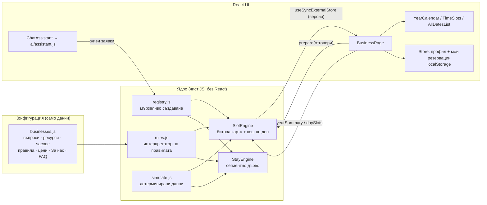

# 📅 Резервирай.бг — универсална система за резервации

Адаптивно уеб приложение (React + Vite, **JavaScript / CSS / HTML**) за резервации в различни видове бизнес. Всеки бизнес се описва **само с конфигурация** (въпроси, ресурси, работно време, правила, цени, информация „За нас“). Едно общо ядро изчислява свободните дати и часове за цялата година.

Данните са симулирани: при първото отваряне на бизнес се генерират хиляди реалистични резервации.

---

## Съдържание

1. [Стартиране](#1-стартиране)
2. [Какво може системата](#2-какво-може-системата)
3. [Архитектура](#3-архитектура)
4. [Модел на данните](#4-модел-на-данните)
5. [Алгоритми и оптимизация](#5-алгоритми-и-оптимизация)
6. [AI асистент](#6-ai-асистент)
7. [Как се добавя нов бизнес](#7-как-се-добавя-нов-бизнес)
8. [Структура на проекта](#8-структура-на-проекта)
9. [Към продукционна среда](#9-към-продукционна-среда)

---

## 1. Стартиране

Изисквания: **Node.js 18+** (препоръчително 20 или 22) и npm.

```bash
npm install          # инсталира React, Vite и React плъгина за Vite
npm run dev          # стартира сървър за разработка → http://localhost:5173
```

Други команди:

```bash
npm run build        # продукционна компилация в папка dist/
npm run preview      # локален преглед на компилираната версия
npm run test:engine  # тестове на алгоритмите в Node (без браузър)
```

По избор може да свържете асистента с външен езиков модел. Копирайте `.env.example` като `.env` и попълнете `VITE_AI_ENDPOINT` (вижте [раздел 6](#6-ai-асистент)).

> Профилът и резервациите на потребителя се пазят в `localStorage`. За да започнете отначало, изчистете данните на сайта в браузъра.

---

## 2. Какво може системата

| Стъпка | Описание |
|---|---|
| **Профил при първо влизане** | Потребителят въвежда адрес, телефон, имейл и три имена и отговаря дали иска SMS потвърждение и напомняне преди посещението (2, 24 или 48 ч.). Всички полета се валидират. |
| **Избор на бизнес** | 8 бизнеса, всеки със свой цвят, въпроси и раздел **„За нас“**: история, адрес, контакти, работно време, предимства, условия, екип и често задавани въпроси. |
| **Въпроси** | Формулярът се генерира от конфигурацията. Има условни полета (например „Разкажете за повода“ се показва, само ако има повод). |
| **Свободни дати и часове за годината** | Годишен календар с 12 месеца, в който цветът показва колко е свободно. При избор на ден се виждат всички свободни часове. Изгледът **„Всички свободни дати и часове“** ги изброява по месеци. |
| **Преглед и потвърждение** | Обобщение на резервацията, данните на клиента и цената. |
| **Плащане** | След резервацията клиентът избира **в брой на място** или **по банков път** (с IBAN, BIC, основание и сума). |
| **Известия (симулирани)** | Потвърждение по имейл, SMS (ако е избрано) и напомняне (ако е избрано). |
| **Моите резервации** | Предстоящи и минали резервации, отказ (местото се освобождава веднага) и избор на плащане, ако не е избрано. |
| **AI асистент** | Чат, който отговаря на въпроси и проверява наличността в реално време. |
| **Оптимизация** | Стрес тест в браузъра, който сравнява алгоритмите с наивен подход. |

### Бизнеси и въпроси

| Бизнес | Въпроси |
|---|---|
| 🍽️ **Ресторант** | за колко души · дата · час · предпочитана маса (вътре / вън / без значение) · хранителни предпочитания · алергии · специален повод (+ описание) |
| 🏨 **Хотел** | за колко души · колко стаи · дата на настаняване (**от 13:00 ч.**) · дата на напускане (**до 11:00 ч.**) · тип стая · тип хранене (**само закуска** / **All inclusive**) · специални желания |
| 💅 **Салон за красота** | маникюр, педикюр или и двете · гел или обикновен лак · премахване на стар материал · дата · час · пожелания за дизайн |
| 🦷 **Дентален център** | вид посещение · за възрастен или дете · първо посещение · предпочитан лекар · алергии към упойка · оплакване · дата · час |
| 🚗 **Автосервиз** | марка и модел · година · гориво · услуги (масло, диагностика, спирачки, климатик, гуми) · заместващ автомобил · изчакване на място · описание на проблема |
| 🏋️ **Фитнес (персонален треньор)** | цел · ниво · индивидуално или в двойка · 60/90 мин. · пол на треньора · здравословни проблеми |
| 💆 **СПА и масажи** | вид масаж · продължителност · 1 или 2 души (двама терапевти **едновременно**) · пол на терапевта · сауна · противопоказания |
| 🐾 **Ветеринарна клиника** | вид животно · име · възраст · причина за посещението · спешност · симптоми |

Отговорите влияят на резултата. Например „Вън (градина)“ показва свободни маси само април–октомври. „Електро“ в автосервиза насочва към подемник с EV оборудване. „Птица“ във ветеринарната клиника насочва към специалиста по екзотични животни. „Масаж за двама“ търси часове, в които са свободни двама подходящи терапевти едновременно.

---

## 3. Архитектура



### Слоеве

1. **Конфигурация** (`src/config/businesses.js`). Всеки бизнес е обект само с данни. В него няма `if (бизнес === 'хотел')`. Правилата са декларативни, например `duration.sum`, `match: [{ op: 'hasAll' }]`, `quantity`.
2. **Ядро** (`src/engine/`). Чист JavaScript, без зависимост от React. Затова се тества в Node (`npm run test:engine`), може да се премести в Web Worker или на сървър без промени.
   - `rules.js` превръща отговорите в **изискване**: продължителност, брой ресурси и кои ресурси стават.
   - `SlotEngine` обслужва бизнеси с часови слотове (7 от 8-те бизнеса).
   - `StayEngine` обслужва бизнеси с нощувки (хотел).
   - Двата двигателя имат **общ интерфейс**: `prepare`, `yearSummary`, `firstAvailable`, `book`, `add`, `remove`, `subscribe`, `getVersion`.
3. **UI** (`src/components/`). Генерични компоненти, които рендерират каквото им подаде конфигурацията.

### Общото между бизнесите

Различните бизнеси имат една и съща същност:

> **Резервация = (кой) + (кога: интервал от време) + (какво: един или повече ресурса, които отговарят на изискванията) + (детайли).**

Разликите са в правилата: колко дълго (ресторант 2 ч., маникюр 60–155 мин.), кой ресурс (маса ≥ гостите, специалист с умение, подемник с EV), колко ресурса наведнъж (масаж за двама) и каква е времевата единица (час или нощувка). Затова ядрото има само два двигателя, а бизнесите се различават по конфигурацията.

### React и състоянието

- Хилядите симулирани резервации **не са в React state**. Те живеят в двигателите и React следи само **номер на версия** чрез `useSyncExternalStore`. Затова промяна в данните не кара React да копира и сравнява големи масиви и обновява само абонираните компоненти.
- Глобалният store (Context + `useReducer`) съдържа само профила и резервациите на потребителя. Те се пазят в `localStorage`.
- Маршрутизация чрез hash (`#/b/hotel`, `#/my`, `#/bench`, `#/profile`), без външни библиотеки.

---

## 4. Модел на данните

### 4.1 Конфигурация на бизнес

```js
{
  id: 'salon', codePrefix: 'BS', name, category, icon, accent, tagline,
  mode: 'slot' | 'stay',
  stepMinutes: 30,            // през колко минути се предлагат начални часове
  leadMinutes: 120,           // минимално време преди резервация за днес
  allocation: 'bestFit' | 'balance',
  hours: [null, '10:00-18:00', '09:00-13:00,14:00-19:00', ...],   // индекс 0 = неделя
  closedDates: ['12-25'],     // почивни дати (ММ-ДД)
  resources: [ { id, name, capacity?, zone?, skills?, gender?, months? } ],
  roomTypes: [ { id, name, count, capacity, price } ],            // само за mode: 'stay'
  questions: [ { id, label, type, options?, min?, max?, default?, required?, showIf?, help? } ],
  rules: {
    duration: { fixed?: 120, sum?: { service: { manicure: 60, both: 135 }, removal: { yes: 20 } } },
    match:    [ { field: 'capacity', op: 'gte', answer: 'guests' },
                { field: 'zone', op: 'eq', answer: 'zone', any: 'any' },
                { field: 'skills', op: 'hasAll', answer: 'service', map: { both: ['manicure','pedicure'] } } ],
    quantity: { answer: 'people', map: { 1: 1, 2: 2 } },
    stay:     { typeAnswer, roomsAnswer, guestsAnswer }           // само за хотел
  },
  price: { label, fixed?, sum?, perAnswer?, multiplyBy?, meal? },  // в евро
  payment: { bankName, iban, bic },
  about: { story, address, phone, email, features[], policies[], team[] },
  faq: [ { q, k: [ключови думи], a } ],
  simulation: { occupancy, lengths[], peakDays[] }
}
```

Типове въпроси: `number`, `radio`, `select`, `multi` (с `exclusive` опция като „Няма“), `text`, `textarea`. Условие за показване: `showIf: { q, eq | neq | in | includes }`.

### 4.2 Вътрешни структури на двигателя

**SlotEngine** (R ресурса, D = 365 дни, S = 96 слота от 15 мин.):

| Структура | Тип | Размер | Предназначение |
|---|---|---|---|
| `occ` | `Uint8Array` | R·D·S | 1 = заета клетка (ресурс, ден, слот) |
| `freeCnt` | `Uint16Array` | R·D | брой свободни работни слотове на ресурс за деня, за бързо отсяване |
| `resOpen` | `Uint8Array` | R·D | работи ли ресурсът този ден (сезонност, почивни дни) |
| `hours[weekday].mask` | `Uint8Array` | S | маска на работното време |
| `dayVersion` | `Uint32Array` | D | брояч на промени по ден |
| `byDay` | `Set[]` | D | id на резервациите в деня (за отказ и изместване) |
| `cache` | `Map` | — | `"ключ на изискване|ден" → {версия, свободни слотове}` |

Пример: ресторант с 22 маси заема 22 × 365 × 96 ≈ **771 KB**. Стрес тестът с 200 ресурса заема 7 MB.

**StayEngine**: едно **сегментно дърво** (`Int32Array`) на тип стая. Стойността в лист *d* е броят заети стаи от този тип в нощта *d*.

### 4.3 Резервация на потребителя (store / localStorage)

```js
{
  id, code: 'RS-7K3P2Q', bizId, bizName, icon, mode, status: 'confirmed' | 'cancelled', createdAt,
  // slot:
  date: '2026-12-24', startMin: 1200, endMin: 1320, time: '20:00 – 22:00', resourceIds: ['t9'], resourceNames: ['Маса 9'],
  // stay:
  checkIn: '2027-02-04', checkOut: '2027-02-06', nights: 2, roomType: 'double', rooms: 1,
  answers: {...}, lines: [{ label, value }], price: 238,
  payment: { method: 'cash' | 'bank', status: 'on_site' | 'awaiting_transfer' } | null,
  notify: { sms: 'yes', reminder: 'yes', reminderBefore: '24h' }
}
```

Резервациите се пазят с **абсолютни дати**, а не с индекс на ден. Така при утрешно отваряне се прилагат правилно към новия хоризонт.

### 4.4 Профил

```js
{ address, phone, email, fullName /* точно 3 думи */, sms: 'yes'|'no', reminder: 'yes'|'no', reminderBefore: '2h'|'24h'|'48h' }
```

---

## 5. Алгоритми и оптимизация

Основният въпрос е как системата да е бърза при много ресурси и много промени. Ето как е решен.

### 5.1 Дискретизация и плоски масиви

Времето е разделено на 15-минутни слотове, а заетостта е в плосък типизиран масив. Проверката „свободен ли е ресурс *r* в ден *d*, слот *s*“ е **O(1)** четене на `occ[(r·D + d)·S + s]`. Няма обекти, указатели и натиск върху garbage collector-а, а достъпът е последователен и затова бърз за кеша на процесора.

### 5.2 Свободни часове за ден за O(R′ · S)

За всеки подходящ ресурс едно обхождане **отзад напред** изчислява:

```
run[i] = (отворено[i] и свободно[i]) ? run[i+1] + 1 : 0
```

Тогава начален час *s* е валиден точно когато `run[s] ≥ дължината`. Всички възможни начала за ресурса се намират с **96 + 48 операции**, независимо от броя резервации. Буферите `run` и `counts` се използват многократно, затова алгоритъмът не заделя памет.

Ако са нужни няколко ресурса едновременно (масаж за двама), `counts[s]` брои колко ресурса са свободни в *s*, и *s* е валиден, когато `counts[s] ≥ qty`.

### 5.3 Отсяване и ранно прекъсване

- **Филтър на кандидатите веднъж.** `prepare()` прилага правилата `match` само веднъж за дадени отговори. В цикъла влизат само подходящите ресурси R′ ≤ R.
- **Отсяване по `freeCnt`.** Ако ресурсът има по-малко свободни слотове за деня от нужната дължина, се пропуска без обхождане.
- **Ранно прекъсване при насищане.** Щом всеки възможен начален час е покрит от достатъчно ресурси, останалите ресурси не се проверяват. С 200 ресурса това намали студеното сканиране на годината от ~55 ms на ~8 ms.

### 5.4 Двустепенен кеш с точкова инвалидация

1. **Кеш по ден.** Ключът е `"дължина|брой|кандидати|ден"`, а стойността пази версията на деня. Нова или отменена резервация увеличава `dayVersion[d]` **само за своя ден**. При следващото сканиране се преизчисляват само дните с променена версия, а останалите 364 идват от кеша.
2. **Кеш за цялата година.** Ако версията на двигателя не се е променила, `yearSummary` връща същия масив за O(1).

Ключът на кеша се изгражда от **ефекта** на отговорите, а не от самите отговори. Затова „Вегетарианско“ и „Веганско“ в ресторанта използват един и същ кеш: те не влияят на наличността.

### 5.5 Хотел: сегментно дърво

| Операция | Наивно | Сегментно дърво |
|---|---|---|
| Нова резервация [a, b) | O(b−a) | **O(log D)**, range add |
| Свободни стаи за престой [a, b) | O(B · (b−a)) при обхождане на резервациите | **O(log D)**, общо − range max |
| Най-късно напускане при настаняване a | — | O(k log D) с инкрементален max |

Резервациите се пазят като инвентар по **тип стая**, а не по физическа стая. Конкретната стая се определя при настаняване, както в реалните хотели. Така се избягва фрагментацията.

### 5.6 Разпределение на ресурси

- `bestFit` (ресторант): избира **най-малката подходяща маса**, за да остане банкетната маса свободна за големи групи.
- `balance` (специалисти): избира **най-слабо натоварения** специалист за деня, за да е натоварването равномерно.

### 5.7 Оптимизации в React

| Техника | Къде | Ефект |
|---|---|---|
| `useSyncExternalStore` + версия | `useEngine` | данните са извън React; обновяват се само абонираните компоненти |
| `useDeferredValue(отговори)` | `BusinessPage` | писането във формуляра остава гладко; годината се преизчислява с по-нисък приоритет |
| `memo` на клетка от календара + примитивни props | `YearCalendar` | при промяна в един ден се преизчертава само той |
| Делегиране на събития | `YearCalendar` | 1 обработчик вместо 365 |
| Мързеливо рендериране | `AllDatesList` | часовете се изчисляват само за отворените месеци |
| Code splitting (`React.lazy`) | Чат, Оптимизация | по-малък начален пакет |
| Мързеливо създаване на двигатели | `registry.js` | данни се генерират само за бизнеса, който е отворен |
| Детерминирана симулация | `simulate.js` | семето е бизнес + календарна дата, затова данните са стабилни между зареждания |

### 5.8 Измерени резултати

Измерено с `npm run test:engine` и страницата **„Оптимизация“** (Node 22 и Chromium, лаптоп от среден клас; числата варират според машината):

| Сценарий | Време |
|---|---|
| Ресторант: 22 маси, ~6 600 резервации, свободни часове за 365 дни (студено) | ~5–9 ms |
| Същото, от кеша | ~0.003 ms |
| Стрес тест: 200 ресурса, ~139 000 резервации, цялата година (студено) | ~8 ms |
| Нова резервация + обновяване на годината | ~1.5 ms |
| Наивен подход (масив от резервации, филтриран при всяка заявка) | ~170–200 ms |
| **Ускорение:** индекс спрямо наивен / кеш спрямо наивен | **~20× / >1000×** |
| Хотел, 200 стаи: всички 7-дневни престои (сегментно дърво спрямо наивно) | 0.3 ms срещу 67 ms (**~220×**) |

Отметката **„поток от промени (10/сек)“** на всеки бизнес добавя и отменя по 10 резервации в секунда. Календарът се обновява на живо, а времето за сканиране остава под милисекунда.

---

## 6. AI асистент

Чатът (бутон **💬 AI асистент** долу вдясно) работи **изцяло локално**, без мрежа и без API ключ:

- **Разпознава намерения** по ключови думи на български: работно време, адрес, контакти, цени, плащане, отказ, настаняване, моите резервации, как се резервира, архитектура и други.
- **Извлича параметри** от свободен текст: дати („утре“, „в събота“, „24.12“, „15 януари“), час („в 20:00“, „към 19 ч“) и брой хора („за 4 души“, „двама“).
- **Отговаря от живите данни.** Въпрос като „Има ли маса утре в 20:00 за 4 души?“ се проверява в двигателя на ресторанта. Ако часът е зает, асистентът предлага най-близките свободни. Затова отговорите съвпадат с календара.
- **Отговаря от конфигурацията**: FAQ на бизнеса, условия, цени и екип. Познава бизнеса от контекста (страницата, на която сте) или от въпроса („…в хотела…“).
- **Вижда текущия избор.** На въпрос „Колко струва?“ изчислява цената за избраните опции.

**Връзка с езиков модел (по избор).** Ако зададете `VITE_AI_ENDPOINT`, въпросите, на които локалният асистент не е сигурен, се препращат към вашия backend заедно с контекста на бизнеса:

```
POST VITE_AI_ENDPOINT
{ "message": "...", "history": [...], "context": { "business": { name, about, faq, hours } } }
→ { "reply": "..." }
```

> Никога не поставяйте API ключ във фронтенд кода. Използвайте сървърен прокси.

---

## 7. Как се добавя нов бизнес

Добавете обект в масива `BUSINESSES` в `src/config/businesses.js`. **Не е нужна промяна в ядрото или в UI.** Пример за бръснарница:

```js
{
  id: 'barber', codePrefix: 'BB', name: 'Бръснарница „Острие“', category: 'Бръснарница',
  icon: '💈', accent: '#7a4b2a', tagline: 'Класическо бръснене и мъжки прически.',
  mode: 'slot', stepMinutes: 15, allocation: 'balance', resourceLabel: 'Бръснар',
  hours: [null, '10:00-19:00', '10:00-19:00', '10:00-19:00', '10:00-19:00', '10:00-19:00', '10:00-15:00'],
  resources: [ { id: 'b1', name: 'Тони', skills: ['cut', 'beard'] }, { id: 'b2', name: 'Краси', skills: ['cut'] } ],
  questions: [
    { id: 'service', label: 'Услуга', type: 'radio', default: 'cut', required: true,
      options: [ { value: 'cut', label: 'Подстригване' }, { value: 'beard', label: 'Брада' }, { value: 'both', label: 'И двете' } ] },
  ],
  rules: {
    duration: { sum: { service: { cut: 30, beard: 20, both: 45 } } },
    match: [ { field: 'skills', op: 'hasAll', answer: 'service', map: { cut: ['cut'], beard: ['beard'], both: ['cut', 'beard'] } } ],
  },
  price: { label: 'Цена', sum: { service: { cut: 15, beard: 10, both: 22 } } },
  payment: { bankName: '…', iban: '…', bic: '…' },
  about: { title: 'За нас', story: '…', address: '…', phone: '…', email: '…', features: [], policies: [], team: [] },
  faq: [],
  simulation: { occupancy: 0.25, lengths: [30, 45] },
}
```

---

## 8. Структура на проекта

```
SMD/
├── index.html
├── package.json
├── vite.config.js
├── .env.example
├── scripts/
│   └── selftest.mjs            # тестове на ядрото (npm run test:engine)
└── src/
    ├── main.jsx                # входна точка
    ├── App.jsx                 # рамка, навигация, мързеливо зареждане
    ├── styles.css              # адаптивен дизайн (CSS променливи, color-mix)
    ├── config/
    │   ├── businesses.js       # ⭐ конфигурация на 8-те бизнеса
    │   └── format.js           # форматиране (часове, пари, дати)
    ├── engine/                 # ⭐ чисто ядро без React
    │   ├── time.js             # слотове, дати, работно време → маски
    │   ├── rules.js            # интерпретатор на декларативните правила
    │   ├── slotEngine.js       # битова карта + алгоритъм за ден + кеш
    │   ├── stayEngine.js       # хотели върху сегментно дърво
    │   ├── segmentTree.js      # range add / range max
    │   ├── simulate.js         # детерминирани симулирани данни + поток от промени
    │   └── registry.js         # мързеливи двигатели + прилагане на резервациите на потребителя
    ├── store/store.jsx         # профил и резервации на потребителя (localStorage)
    ├── hooks/hooks.js          # useEngine (useSyncExternalStore), hash router
    ├── ai/
    │   ├── assistant.js        # локален NLU + отговори от живите данни
    │   ├── provider.js         # по избор: външен LLM през backend
    │   └── context.js          # споделен контекст страница → чат
    └── components/
        ├── Onboarding.jsx      # 6-те въпроса при първо влизане / профил
        ├── BusinessList.jsx
        ├── BusinessPage.jsx    # формуляр + календар + процес на резервация
        ├── QuestionForm.jsx    # генеричен формуляр от конфигурацията
        ├── YearCalendar.jsx    # 12 месеца, memo клетки
        ├── TimeSlots.jsx
        ├── AllDatesList.jsx    # всички свободни дати и часове (мързеливо)
        ├── AboutCard.jsx       # „За нас“
        ├── Checkout.jsx        # преглед → плащане → готово
        ├── MyBookings.jsx
        ├── ChatAssistant.jsx
        └── Benchmark.jsx       # стрес тест
```

---

## 9. Към продукционна среда

Ядрото е чист JavaScript, затова същите структури могат да работят на сървъра (Node) или в Web Worker. Препоръчителните стъпки:

1. **Backend + база данни.** Резервациите се пазят в PostgreSQL. Двойните резервации се предотвратяват на ниво база с `EXCLUDE USING gist (resource_id WITH =, tstzrange(start, end) WITH &&)`. Индексът в паметта (битовата карта) се поддържа като кеш по бизнес.
2. **Промени в реално време.** Сървърът изпраща събития `booking.created` и `booking.cancelled` (WebSocket или SSE). Клиентът извиква `engine.add` или `engine.remove`. Инвалидацията по ден вече е готова за това.
3. **Оптимистично заключване.** `book()` вече връща `null`, ако слотът е зает между избора и потвърждението. UI показва съобщение и предлага друг час. На сървъра същото става с транзакция.
4. **Web Worker** за много големи бизнеси (хиляди ресурси), за да не блокира основната нишка.
5. **Реални известия.** SMS и имейл през доставчик, напомнянията се планират в опашка (cron или job queue) по `notify.reminderBefore`.
6. **Реално плащане.** Банковият превод се сверява по основанието (код на резервацията), а може да се добави и картово плащане.

---

*Всички бизнеси, имена, адреси, телефони и банкови сметки в демото са измислени.*
